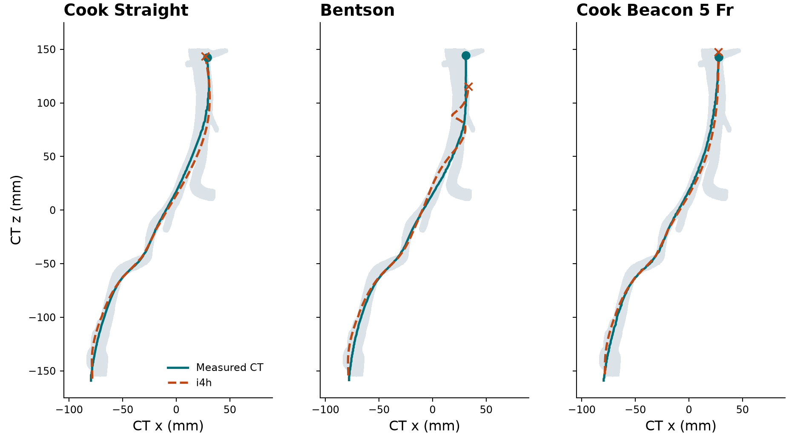

# Catheter and guidewire validation

i4h RodDirect, SOFA and Newton VBD agree on the prescribed-displacement
three-point bend for 11 guidewire shafts and four catheter shafts. The Elastrat
phantom test measures how closely i4h reproduces the instrument shapes and tip
positions seen on CT.

## Shaft bending

We placed a 60 mm shaft across two sliding guides 40 mm apart and moved its
midpoint at 20 mm/min to 5 mm. All three solvers used the same bending rigidity
(EI) for each shaft. The i4h fixture solves both guide reactions and the nose
reaction together with the rod at a **1 ms substep and two iterations**.
[Coupled fixture and reproduction commands](validation/rod_coupled_gpu/README.md)

For the guidewires, we derived EI from the published initial force slope over
the first 0.3 mm using **EI = slope × span³ / 48**. For the catheters, we used
the Imperial flexural modulus measured 31 cm from the tip and the documented
outer and lumen diameters. The guidewire slopes set the inputs, and the
catheter archive has no independent force traces. This test measures agreement
among the three solvers for the same inputs. [Harrison et al., *Guidewire Stiffness: What’s in a Name?* (2011)](https://doi.org/10.1583/11-3592.1) · [Catheter inputs](validation/imperial/catheter_bending/inputs.csv)

Across all 15 shafts, i4h's force differed by at most **0.42% from SOFA** and
**0.54% from Newton VBD** at the reporting displacements. Over 0.3–4.8 mm,
the worst normalized RMS force-curve differences were **0.53%** and **0.68%**,
respectively. The public sync branch reproduced all 15 coupled CPU traces
and both CUDA checks sample for sample.

| Instrument | Displacement (mm) | i4h (N) | SOFA (N) | Newton VBD (N) |
| --- | ---: | ---: | ---: | ---: |
| Amplatz Extra Stiff | 4.407 | 2.633 | 2.630 | 2.631 |
| Lunderquist Extra Stiff | 4.407 | 14.296 | 14.280 | 14.276 |
| Cordis Angiographic 4 Fr | 4.0 | 0.536 | 0.535 | 0.534 |
| Terumo Straight 4 Fr | 4.0 | 0.270 | 0.269 | 0.269 |
| Terumo Straight 5 Fr | 4.0 | 0.228 | 0.227 | 0.227 |
| Cook Beacon Royal Flush 5 Fr | 4.0 | 0.871 | 0.869 | 0.867 |

## Shape inside the Elastrat phantom

We inserted each virtual instrument into the registered silicone phantom under frictionless contact, using a common 25 mm/s feed without steering. For each scan, we matched the length beyond its entry plane within 0.27 mm. We kept the registration fixed and used no CT coordinates to steer the rod or fit its stiffness. The three depths correspond to the iliac bifurcation, aortic bifurcation and left renal artery origin. The public sync replay reproduced all 45 archived comparisons using the original open phantom mesh.

The six guidewires use measured stiffness profiles along the shaft. Cook Straight has an independent bench force curve giving an apparent EI of **246.65 N·mm²**. The other wires scale from this value under a common effective-section assumption. Guidewire contact diameter was set to 0.889 mm throughout. The curved tips use approximate unloaded geometry and a common assumed roll. The three catheter models use uniform shaft stiffness. Cordis has no matching CT scan.

*Projection onto the CT x–z plane at the deepest insertion. The circle marks the measured tip and the cross marks the simulated tip. The table reports three-dimensional errors.*

| Instrument | Iliac RMS (mm) | Aortic RMS (mm) | Left renal RMS (mm) | Left renal tip error (mm) |
| --- | ---: | ---: | ---: | ---: |
| Cook Straight | 2.21 | 1.95 | 2.77 | 2.38 |
| Cook Safe-T-J | 2.30 | 2.45 | 3.34 | 6.61 |
| Cook Rosen | 2.70 | 1.66 | 2.35 | 6.54 |
| Amplatz Super Stiff | 3.45 | 3.98 | 2.89 | 11.07 |
| Bentson | 5.43 | 5.74 | 5.21 | 32.77 |
| Terumo Stiff Angled | 3.48 | 2.92 | 2.34 | 1.75 |
| Terumo Straight 4 Fr | 2.28 | 2.35 | 5.68 | 13.69 |
| Terumo Straight 5 Fr | 2.05 | 2.16 | 6.13 | 11.59 |
| Cook Beacon 5 Fr | 1.77 | 2.66 | 2.53 | 5.13 |

**Centreline RMS** is the root mean square distance from each inserted simulated node to its nearest measured CT sample. **Tip error** is the direct distance between the simulated and scanned tips. Bentson illustrates the distinction: its deepest shaft RMS was 5.21 mm while its tip missed by 32.77 mm.

The guidewire stiffness profile changed the outcome in both directions. With a uniform shaft, Amplatz Super Stiff escaped the lumen at depths 2 and 3 and its deepest tip missed by 82.14 mm. With its measured profile, the deepest tip error fell to 11.07 mm. Bentson’s deepest tip error rose from 8.30 to 32.77 mm. The surface check found all sampled simulated points inside the lumen in the 18 saved profiled-guidewire configurations and nine saved catheter configurations. This check covers the sampled frames in the reconstructed mesh.

## Reproduce the experiments

[Inputs, environment setup, run commands and full instrument overlays](validation/README.md)

The Imperial bending methods are described by Tang et al. in *A Realistic
Elastic Rod Model for Real-time Simulation of Minimally Invasive Vascular
Interventions*. The phantom and scan protocol are described by Korzeniowski et
al. in *Simulation of Catheters and Guidewires for Cardiovascular Interventions
Using an Inextensible Cosserat Rod*, ISBMS 2014, pp. 112–121.
