# Performance

This page answers three questions for anyone deciding whether i4h's Newton-based physics is fast enough for
their work:

1. How fast does a surgical scene simulate, and how does that change as you run more copies of it in parallel?
2. How many parallel copies can you run while each one still runs in real time (60 frames per second) or at 30?
3. How does that compare with [SOFA](https://www.sofa-framework.org/), the most widely used open-source simulation
   framework for medical and surgical simulation, on the same scene and the same machine?

Every number on this page was measured on the workstation described under [Test machine](#test-machine), and every
measurement can be repeated with the commands under [Reproduce the measurements](#reproduce-the-measurements).

## Key results

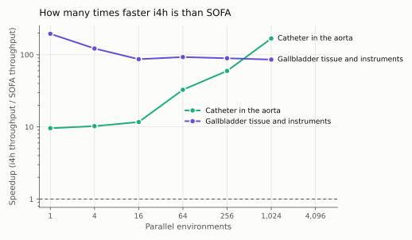

| Scene | Simulator | Environments at 60 frames/s or more (real time) | Environments at 30 frames/s or more | Most simulation per second (environment frames/s) |
| --- | --- | ---: | ---: | ---: |
| Catheter in the aorta | i4h | 64 (98 frames/s each) | 1,024 (33 frames/s each) | 97,458, at 4,096 environments |
| Catheter in the aorta | SOFA | none: 14 frames/s with a single environment | none | 201, at 1,024 environments |
| Gallbladder tissue and instruments | i4h | 16 (106 frames/s each) | 64 (31 frames/s each) | 1,952, at 64 environments |
| Gallbladder tissue and instruments | SOFA | none: 2.4 frames/s with a single environment | none | 21, at 256 environments |

The environment counts are the largest measured counts (1, 4, 16, 64, 256, 1,024, 4,096) that meet the frame rate.

- **i4h is 10 to 168 times faster than SOFA on the catheter scene, and 86 to 195 times faster on the soft-tissue
  scene**, for the same number of parallel environments on the same workstation.
- **The catheter gap grows with scale.** SOFA's throughput stops growing once every CPU core is busy (from about
  24 environments), while the GPU keeps absorbing more environments. From 1 to 4,096 environments i4h's throughput
  grows 717 times, while the time to advance all of them by one frame grows only from 7 ms to 42 ms.
- **In simulated time:** one second of computing produces 27 minutes of simulated catheter navigation with i4h
  (4,096 environments) and 3.3 seconds with SOFA. For the tissue scene it is 33 seconds against 0.35 seconds.
- **Neither SOFA scene runs in real time on this machine, even with a single environment.** i4h runs a single
  catheter at 136 frames/s and a single tissue scene at 470 frames/s.

Both SOFA replicas simulate slightly less than i4h does, so these speedups are conservative; see
[Is the comparison fair?](#is-the-comparison-fair).

## How to read the numbers

- **Environment.** One independent copy of a scene: one patient anatomy with its own instruments, its own motion
  and its own physical state. Reinforcement learning and synthetic-data generation run hundreds or thousands of
  environments side by side, each trying something different.
- **Frame.** One step of 1/60 s of simulated time. Inside every frame the solver takes 8 smaller substeps, in both
  simulators, so the motion stays stable.
- **Throughput (environment frames per second).** The total amount of simulation done per second of wall-clock
  time, summed over all environments. Higher is better. This is what decides how fast a training run or a dataset
  finishes.
- **Frame rate of each environment (frames per second).** How many frames every single environment advances per
  second of wall-clock time when all of them run together. 60 means every environment runs in real time; 30 is half
  speed, still smooth for an interactive view.
- **How each simulator runs parallel environments.** i4h simulates all environments together as one batch on the GPU.
  SOFA computes one scene on one CPU core, so parallel environments are spread over one process per physical CPU
  core (24 here), the standard way to run many SOFA scenes. Both simulators use the whole machine they were built
  for.

## Test machine

| Part | Details |
| --- | --- |
| GPU | NVIDIA RTX PRO 6000 Blackwell Workstation Edition: 188 streaming multiprocessors, 96 GB (97,887 MiB) GDDR7, 600 W power limit, PCIe 5.0 x16, compute capability 12.0 |
| GPU driver | 595.99.02 (CUDA 13.2) |
| CPU | AMD Ryzen Threadripper PRO 7965WX: 24 cores / 48 threads, up to 5.36 GHz, 128 MiB L3 cache |
| Memory | 64 GB (62 GiB usable) |
| Operating system | Ubuntu 24.04.5 LTS, Linux 7.0.0 |
| i4h | this branch on `sync/internal-2026-11-23` (`b1c41f9`); Python 3.12.12, Warp 1.17.0, Newton 1.9.0.dev0 (`7f0c13af`), NumPy 2.4.6, Torch 2.14.0+cu130 from the locked numerical environment |
| Isaac Lab | `4cfdfcfa` (the revision i4h is qualified against), its own locked environment: Newton `7f0c13af`, Warp 1.17.0, Torch 2.11.0+cu130 |
| SOFA | v26.06.00 binary release for Python 3.12 (`7c18e95`), SofaPython3 and BeamAdapter from the release, NumPy 2.5.5 |

The measurements ran one at a time with no other benchmark or GPU work on the machine (CPU load average 1.3 of
48 threads before the SOFA runs). The GPU reported no clock-throttle reason in any sample (every 2 s); it peaked
at 390 W of its 600 W limit and 71 °C.

## Experiment 1: catheter navigation in the aorta

### What is simulated: catheter

A catheter, a thin flexible tube, is pushed from the leg artery up the aorta towards the heart. The simulator
computes how the catheter stretches, bends and twists along its length, and keeps it inside the vessel by detecting
where it touches the vessel wall and pushing it back into the lumen. The vessel itself does not move. Each environment
pushes its catheter at its own constant speed (environment `e` of `E` at `0.25 (e + 1) / E` m/s) while slowly
twisting it back and forth and bending its tip. The catheter starts straight on its insertion guide; within the first
frames the vessel wall pulls it into the artery. The scene is modelled at an enlarged scale, as in the source scene
it was ported from; both simulators use the same geometry.

| Start (0 s) | Middle (1.9 s) | End (3.9 s) |
| --- | --- | --- |
| 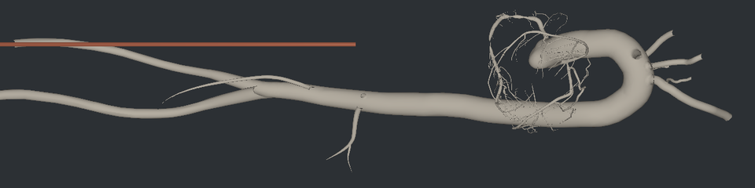 | 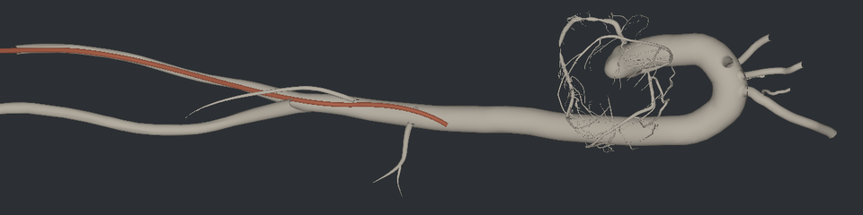 |  |

### Catheter scene size, per environment

| Component | Vertices | Triangles | Simulated nodes | Role |
| --- | --- | --- | --- | --- |
| Aorta with branches | 22,539 | 44,688 | none (static) | Vessel wall the catheter must stay inside; shared by all environments |
| Catheter | n/a | n/a | 192 nodes, 5 cm apart (9.55 m) | Cosserat rod: 191 stretch/shear segments and 191 bend/twist constraints; 2 cm radius, 1 kg per node |
| Insertion guide | n/a | n/a | none | Straight 6.35 m track that holds the catheter's proximal part |

### Catheter physics setup

| | i4h | SOFA replica |
| --- | --- | --- |
| Catheter model | Cosserat rod (position-based XPBD), stretch/shear, bend and twist | BeamAdapter `RodStraightSection` + `AdaptiveBeamForceFieldAndMass` (Timoshenko beams), the standard SOFA catheter model |
| Solver | Direct block-Thomas solve along the rod, 1 iteration per substep | Implicit Euler with `BTDLinearSolver` (block-tridiagonal direct solve) |
| Time stepping | 1/60 s frames, 8 substeps | 1/60 s frames, 8 steps of 1/480 s |
| Contact | Rod nodes projected back inside the vessel mesh (9 cm search) | Frictional contact (`LocalMinDistance`, `LCPConstraintSolver`, friction 0.1), catheter lines and points against the vessel triangles |
| Controls | Scripted insertion speed, rotation and tip bend (`measure.py --navigation`) | The same insertion speed and rotation through `InterventionalRadiologyController`; BeamAdapter has no steerable tip, so no tip bend |
| Gravity | Off | Off |

### Results

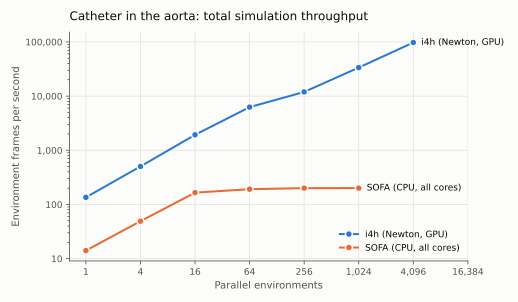

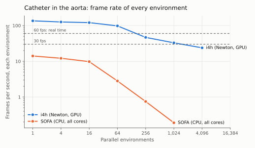

| Environments | i4h: environment frames/s | i4h: frame time (ms) | i4h: frames/s per environment | SOFA: environment frames/s | SOFA: frame time (ms) | SOFA: frames/s per environment | i4h speedup |
| ---: | ---: | ---: | ---: | ---: | ---: | ---: | ---: |
| 1 | 136 | 7.4 | 135.5 | 14.1 | 71 | 14.07 | 10x |
| 4 | 504 | 7.9 | 125.9 | 49.2 | 82 | 12.14 | 10x |
| 16 | 1,931 | 8.3 | 120.7 | 165.4 | 102 | 9.78 | 12x |
| 64 | 6,261 | 10.2 | 97.8 | 191.6 | 355 | 2.81 | 33x |
| 256 | 11,939 | 21.4 | 46.6 | 200.2 | 1,335 | 0.75 | 60x |
| 1,024 | 33,641 | 30.4 | 32.9 | 200.7 | 5,261 | 0.19 | 168x |
| 4,096 | 97,458 | 42.0 | 23.8 | not run | not run | not run | n/a |

What the charts show:

- **i4h.** Up to 64 environments, adding environments is almost free: every environment still gets 98 frames per
  second or more, and throughput grows almost in proportion to the number of environments. Beyond that the GPU is
  busy and each frame takes longer, but much less than the number of environments grows: going from 1,024 to 4,096
  environments (4 times more) makes a frame only 1.4 times slower, so throughput keeps rising.
- **SOFA.** One catheter takes 71 ms per frame (14 frames/s). Up to 16 environments, each running on its own CPU core,
  throughput grows almost in proportion. Once the 24 cores are full, further environments wait for a free core:
  throughput stays at about 200 environment frames per second and each environment slows down in proportion
  (0.19 frames/s at 1,024 environments). Single-environment frames also slow from 71 ms to 102 ms when 16 run at
  once, probably because the cores share the memory system.
- **Memory.** At 1,024 environments the SOFA processes used 53 GB of the machine's 64 GB, so this is about the
  largest SOFA run this workstation can hold. i4h's simulation used 0.2 GB of GPU memory at 1,024 environments and
  0.9 GB at 4,096 (2.5 GB in use on the whole GPU, of 96 GB).

### Isaac Lab reinforcement-learning task: ReachTarget

`I4h-ReachTarget-Direct` is the same scene as an Isaac Lab task: the policy must bring the catheter tip within 10 cm
of a target point in the aorta and hold it there for 0.5 s. The policy sends insertion, rotation and tip-bend rates.
Here a random policy drives it, and every policy step advances 2 frames (decimation 2). The time includes Isaac
Lab's observation, reward and reset work, which the standalone measurements above do not have.

| Environments | Median / p95 ms per policy step | Policy steps per second (all environments) | Frames per second, each environment |
| ---: | ---: | ---: | ---: |
| 1 | 15.5 / 16.3 | 64 | 129.0 |
| 4 | 17.0 / 17.7 | 236 | 117.9 |
| 16 | 17.8 / 18.5 | 896 | 112.1 |
| 64 | 21.7 / 22.4 | 2,956 | 92.4 |
| 256 | 44.6 / 45.5 | 5,737 | 44.8 |
| 1,024 | 62.9 / 63.6 | 16,274 | 31.8 |

The manager-based variant `I4h-ReachTarget-Manager` at 64 environments: 22.0 / 23.4 ms (+1.8% against `-Direct`).

Isaac Lab adds little on top of the simulation: at 1,024 environments a policy step (2 frames) takes 62.9 ms, which
is 31.5 ms per frame against 30.4 ms in the standalone measurement. Policy throughput keeps growing with the number
of environments, to 16,274 policy steps per second at 1,024 environments, while every environment stays above
30 frames/s.

### Memory as the number of environments grows

`scripts/measure.py aorta_static` with zero controls, three fresh-process trials per size, 20 warm-up and
200 timed frames. Warp memory is what i4h allocates for the simulation; whole-GPU memory includes the CUDA runtime
and display.

| Environments | Frame time, median / p95 (ms) | Warp memory, loaded / after frames / peak (MB) | Earlier GB300 run: median / p95 (ms), Warp peak (MB) |
| ---: | ---: | ---: | ---: |
| 64 | 10.08 / 10.69 | 21.2 / 21.2 / 23.5 | 125.8 / 131.7, 20.0 |
| 256 | 21.30 / 22.16 | 61.5 / 61.5 / 63.7 | 266.1 / 272.3, 56.2 |
| 1,024 | 31.29 / 32.81 | 222.9 / 222.9 / 224.5 | 301.3 / 313.6, 201.0 |

The last column comes from the previous version of this page: an NVIDIA GB300 that reported hardware power-brake
slowdown in every telemetry sample, with Newton 1.6.1. Its frame times are therefore not a healthy-hardware baseline.
Memory agrees within 10 to 20%. All nine runs here exited normally with finite final positions and velocities.

## Experiment 2: gallbladder removal (cholecystectomy) tissue

### What is simulated: tissue

The liver, the fat around the gallbladder and the gallbladder itself are soft tissue, modelled as volumes made of
small tetrahedra. Gravity pulls the tissue down; it hangs from a region on the back of the liver, the three organs are
glued together where they touch, and the fat and gallbladder rest against the inside of the abdominal cavity. Five
laparoscopic instruments (grasper, hook, clip applier, scissors and suction tube) enter through fixed ports in the
abdominal wall and push into the tissue. Here every environment moves its instruments randomly within 0.5 units
of their starting poses.

Two versions of the scene are measured:

- **Tissue and instruments (matched)**: only what SOFA also models here: the soft tissue, the hanging region, the
  connections between organs, cavity contact and instrument contact
  ([`chole_tissue.yaml`](../scripts/benchmark/chole_tissue.yaml)). This is the head-to-head comparison.
- **Full surgical scene**: the shipped `chole_tet_med` case with everything on: grasping, cautery heating and
  burning fat, cutting, clipping and bleeding of the cystic artery and duct, tearing, blood and irrigation fluids,
  suction and smoke. SOFA has no like-for-like setup of all these together, so this one is measured for i4h only.

| | Start (0 s) | Middle | End |
| --- | --- | --- | --- |
| Tissue and instruments |  | 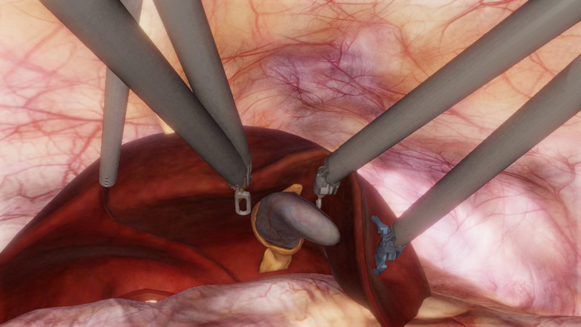 | 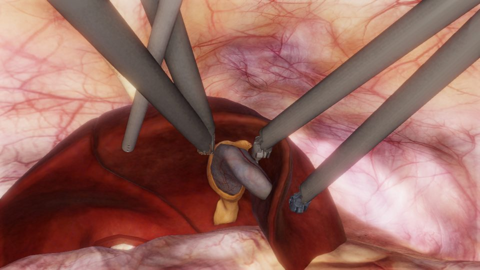 |
| Full surgical scene | 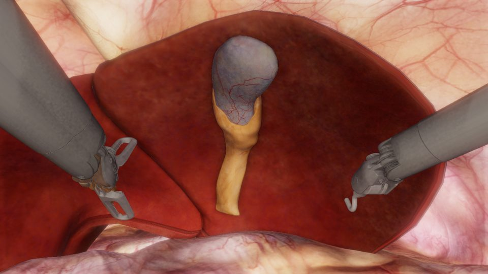 | 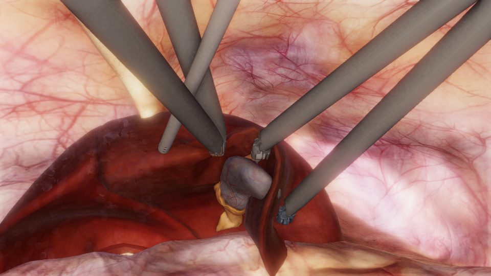 | 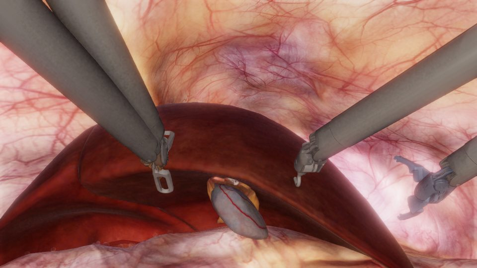 |

The screenshots come from the standalone viewer's scripted instrument motion (the middle and end frames are at
1.9 s and 3.9 s for the tissue scene, and at 2.4 s and 4.9 s for the full scene); the timed runs below use the
random motion described above.

### Tissue scene size, per environment

| Component | Vertices | Tetrahedra | Surface triangles | Role |
| --- | --- | --- | --- | --- |
| Liver | 1,986 | 6,653 | 3,968 | Stiffest tissue; 391 particles on its back rim hold the tissue up |
| Fat | 2,688 | 9,102 | 5,372 | Softest tissue; can be burnt, cut and torn in the full scene |
| Gallbladder | 938 | 3,068 | 1,872 | Carries the cystic artery (14 nodes) and duct (11 nodes) in the full scene |
| Tissue total | 5,612 particles | 18,823 | 11,212 | One soft body; 30,038 edges; 1,479 connectors glue fat to liver and gallbladder to fat |
| Abdominal cavity | 12,427 | n/a | 18,868 | Static wall the fat and gallbladder rest on; shared by all environments |
| Instruments (5) | 149,012 (render meshes) | n/a | 197,361 (render meshes) | Visual only; collisions use 408 spheres and 17 capsules |
| Blood and irrigation (full scene only) | 12,288 particle slots | n/a | n/a | 4,096 blood + 8,192 irrigation fluid particles |

### Tissue physics setup

| | i4h | SOFA replica |
| --- | --- | --- |
| Tissue model | Position-based (XPBD) edge-length and volume constraints per tetrahedron, per-part stiffness 1.0 / 0.1 / 0.8 | Corotational linear elasticity (`TetrahedronFEMForceField`, large deformation) per part, Young's modulus in the same 1.0 / 0.1 / 0.8 ratio |
| Solver | 8 constraint iterations per substep | Implicit Euler with a conjugate-gradient solve, 25 iterations per step |
| Time stepping | 1/60 s frames, 8 substeps | 1/60 s frames, 8 steps of 1/480 s |
| Hanging region | Soft attachment of 391 liver particles | Springs to the rest position on the same 391 particles |
| Organ connections | 1,479 particle-to-triangle connectors | 3 springs per connector, to the triangle's corners, weighted by the same barycentric coordinates |
| Cavity contact | Fat and gallbladder particles projected out of the cavity mesh | Fat and gallbladder surface points against the cavity triangles (`MinProximityIntersection`, penalty contact) |
| Instrument contact | Tissue surface against 408 instrument spheres and 17 capsules | Tissue surface triangles against the same 408 spheres replaying the positions i4h computed (capsules not replicated) |
| Gravity | -9.81 m/s² | -9.81 m/s² |

SOFA's stiffness and damping were chosen so the tissue settles to the same sag as in i4h: 0.23 m mean particle
displacement under gravity in SOFA, 0.22 m in i4h.

### Results: tissue and instruments, i4h and SOFA

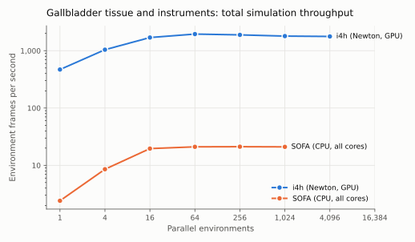

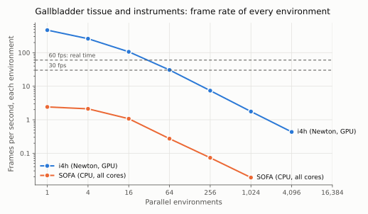

| Environments | i4h: environment frames/s | i4h: frame time (ms) | i4h: frames/s per environment | SOFA: environment frames/s | SOFA: frame time (ms) | SOFA: frames/s per environment | i4h speedup |
| ---: | ---: | ---: | ---: | ---: | ---: | ---: | ---: |
| 1 | 470 | 2.1 | 469.5 | 2.4 | 415 | 2.41 | 195x |
| 4 | 1,042 | 3.8 | 260.4 | 8.6 | 472 | 2.12 | 122x |
| 16 | 1,699 | 9.4 | 106.2 | 19.6 | 933 | 1.07 | 87x |
| 64 | 1,952 | 32.8 | 30.5 | 21.0 | 3,664 | 0.27 | 93x |
| 256 | 1,889 | 135.5 | 7.4 | 21.1 | 13,613 | 0.07 | 89x |
| 1,024 | 1,799 | 569.1 | 1.8 | 21.0 | 52,799 | 0.02 | 86x |
| 4,096 | 1,773 | 2,309.6 | 0.4 | not run | not run | not run | n/a |

What the charts show:

- **i4h.** A single tissue environment takes 2.1 ms per frame (470 frames/s). Each environment has 5,612 particles
  and 18,823 tetrahedra, about 30 times more simulated points than a catheter, so the GPU is fully used from about
  64 environments. From there, throughput stays between 1,770 and 1,950 environment frames per second and the frame
  time grows in proportion to the number of environments: more environments share the same amount of work per
  second. 4,096 environments (23 million particles, 22 GB of GPU memory) still run, at 0.43 frames/s each.
- **SOFA.** One environment takes 415 ms per frame (2.4 frames/s). Throughput levels off at about 21 environment
  frames per second once the 24 cores are busy.
- **Result.** i4h stays 86 to 93 times ahead at every count from 16 to 1,024 environments. To keep every environment
  at 30 frames/s or more, i4h can run 64 environments; SOFA cannot run one.

### Results: full surgical scene in Isaac Lab (GraspTarget)

`I4h-GraspTarget-Direct` is the full scene as an Isaac Lab task: the policy must close the grasper on a point of the
gallbladder and hold it for 0.5 s. A random policy drives all five instruments, including cautery, clip firing,
cutting and irrigation, so the work per frame grows as the random actions burn, cut and fill the scene with fluid.
Every policy step advances 2 frames.

| Environments | Median / p95 ms per policy step | Policy steps per second (all environments) | Frames per second, each environment |
| ---: | ---: | ---: | ---: |
| 1 | 28.4 / 35.0 | 35 | 70.5 |
| 4 | 40.4 / 51.5 | 99 | 49.5 |
| 16 | 71.2 / 80.8 | 225 | 28.1 |
| 64 | 165.6 / 210.0 | 387 | 12.1 |
| 256 | 602.6 / 773.5 | 425 | 3.3 |
| 1,024 | 2,374.8 / 3,264.0 | 431 | 0.8 |

The manager-based variant `I4h-GraspTarget-Manager` at 64 environments: 168.0 / 210.8 ms (+1.5% against `-Direct`).

The full scene costs more than the matched tissue scene: at 64 environments a frame takes 83 ms (half a 165.6 ms
policy step) against 32.8 ms, about 2.5 times as much, and throughput levels off at about 860 frames per second
(431 policy steps per second). One environment runs at 70 frames/s and four at 50 frames/s each. The p95 times are
well above the medians because random burning, cutting and fluid make some frames much more expensive than others.

## Is the comparison fair?

What is the same in both simulators:

- The geometry: SOFA loads the vessel, tissue, connector, hanging-region and cavity data that i4h itself builds
  (`scripts/benchmark/export_scene.py`), so vertex, element and triangle counts are identical.
- Simulated time per frame (1/60 s), the number of substeps (8), gravity, particle masses and the motion: the catheter
  follows the same insertion and rotation script, and SOFA's instrument spheres replay the positions i4h computed for
  the same random actions.
- The timing: wall-clock time around the simulation step only, after scene construction and warm-up, on an otherwise
  idle machine.

What differs, and in whose favour:

- **Physics method.** i4h uses position-based dynamics (XPBD) with projection contact; SOFA uses its standard
  force-based finite elements and beams with implicit integration and penalty or complementarity contact. These are
  the methods each framework is designed and normally used with. They are not numerically identical, so this page
  compares the cost of simulating the same scene to a similar level of physical behaviour, not identical
  trajectories.
- **SOFA simulates less** in several places, which makes SOFA's numbers best cases: only the deployed part of the
  catheter is simulated, there is no tip bending, the instruments' capsules are not collided, and the catheter's
  contact search distance is 3 cm rather than i4h's 9 cm (9 cm makes SOFA about 4 times slower on this scene).
- **Hardware.** i4h runs on the GPU; SOFA on all 24 CPU cores. Both are the hardware the frameworks are built
  for. SOFA's optional CUDA plugin (SofaCUDA) accelerates some force fields and simple collision models, but not
  BeamAdapter's catheter model or the constraint solver, and it runs one scene per process like the CPU version. It
  was not measured here.

## Reproduce the measurements

All commands run from `numerical_sim/` with the production assets in `data/`:

```bash
export I4H_DATA="$PWD/data"
mkdir -p results
# i4h, one fresh process per environment count
uv run python scripts/benchmark/i4h_scaling.py aorta_static --controls navigation --envs 1 4 16 64 256 1024 4096 --warmup 20 --frames 100 --json results/i4h-aorta.json
uv run python scripts/benchmark/i4h_scaling.py scripts/benchmark/chole_tissue.yaml --controls random --envs 1 4 16 64 256 1024 4096 --warmup 10 --frames 30 --json results/i4h-tissue.json
# the scenes as i4h builds them, with 64 recorded instrument trajectories for SOFA
uv run python scripts/benchmark/export_scene.py aorta --out results/aorta.npz
uv run python scripts/benchmark/export_scene.py tissue --out results/tissue.npz --record-envs 64 --frames 41 --seed 0
# SOFA: download, verify and set up v26.06.00, then run the replicas on every physical core
scripts/benchmark/setup_sofa.sh results/sofa
source results/sofa/sofa-env.sh
"$SOFA_PYTHON" scripts/benchmark/sofa_scaling.py aorta --scene results/aorta.npz --envs 1 4 16 64 256 1024 --warmup 20 --frames 100 --json results/sofa-aorta.json
"$SOFA_PYTHON" scripts/benchmark/sofa_scaling.py tissue --scene results/tissue.npz --envs 1 4 16 64 256 1024 --warmup 10 --frames 30 --json results/sofa-tissue.json
# charts
uv run --with matplotlib python scripts/benchmark/plot_scaling.py results --out physics/images/performance
```

Memory (three trials per size):

```bash
for trial in 1 2 3; do
    for envs in 64 256 1024; do
        uv run python scripts/measure.py aorta_static --envs "$envs" --warmup 20 --steps 200 --json "measure-aorta-static-$envs-$trial-rows.json"
    done
done
```

Isaac Lab tasks, with `LAB_PY` the interpreter of an Isaac Lab `4cfdfcfa` environment with the six i4h wheels
installed (see the [ReachTarget example](../isaaclab/reach-target-example.md)):

```bash
for task in ReachTarget GraspTarget; do
    for envs in 1 4 16 64 256 1024; do
        "$LAB_PY" scripts/isaaclab_run.py --task "I4h-$task-Direct" --num_envs "$envs" --steps 300 --policy random --seed 0 --visualizer none
    done
done
```

Screenshots: the standalone viewer from [i4h-standalone-simulator](https://github.com/isaac-for-healthcare/i4h-standalone-simulator)
(`i4h-sim <case> --render slang --input scripted --capture DIR`), with the case's `render` block set to
`window: false`, then the first, middle and last captured frames.

## Earlier measurements

These results come from the previous version of this page. They used other machines or code revisions and are kept
for reference; the measurements above replace them.

**Isaac Lab schedules, 64 environments (v0.9.0).** Median environment physics steps per second over three
fresh-process trials, each with 64 warm-up and 1,024 measured physics samples per environment. `arena` and `newton`
were the Arena and direct Newton schedules; decimation is the number of physics samples per policy step. These runs
predate the last v0.9.0 setup and rendering changes, and the command that produced them is not recorded.

| Schedule | Execution | Decimation | Median environment physics steps/s |
| --- | --- | --- | --- |
| arena | eager | 1 | 5739 |
| arena | eager | 8 | 6077 |
| arena | captured | 1 | 5704 |
| arena | captured | 8 | 5986 |
| newton | eager | 1 | 6030 |
| newton | eager | 8 | 5926 |
| newton | captured | 1 | 5950 |
| newton | captured | 8 | 6068 |

**Direct and manager-based Isaac Lab tasks, 64 environments (2026-10-29).** The same `isaaclab_run.py` command as above
on this workstation with Isaac Lab 6864dd1 and Newton 1.6.1: ReachTarget 22.592 / 23.729 ms (`-Direct`, median / p95)
and 22.582 / 23.467 ms (`-Manager`); GraspTarget 174.158 / 221.695 ms and 176.934 / 220.776 ms.

**Larger environment counts on a remote server (2026-10-29).** Two NVIDIA RTX PRO 6000 Blackwell Server Edition GPUs,
Isaac Lab 6864dd1, `-Direct` on GPU 0 and `-Manager` on GPU 1 at the same time, one run each (branch commit
`29bf9b8`). Median ms per policy step:

| Task, environments | `-Direct` | `-Manager` |
| --- | --- | --- |
| ReachTarget, 64 | 27.0 | 27.6 |
| ReachTarget, 256 | 61.4 | 62.3 |
| ReachTarget, 1024 | 101.2 | 103.4 |
| GraspTarget, 64 | 552 | 557 |
| GraspTarget, 256 | 2,278 | 2,291 |
| GraspTarget, 1024 | 10,102 | 10,152 |

GraspTarget used 15.7 GB of device memory at 1024 environments.

**Training (2026-10-29).** `--task I4h-ReachTarget-{Direct,Manager} --num_envs 64 --train 50 --seed 0` (the
[ReachTarget example](../isaaclab/reach-target-example.md)): 0.58 and 0.59 s per iteration, the same logged mean reward
at every iteration (0.00 for the first three, 0.94 by iteration 25, 0.93 at the end) and the same final losses
(value 0.0001475, surrogate -0.003574, entropy 4.229). The two `model_49.pt` checkpoints were byte-identical
(SHA256 `7ba558d6...672a83`).
